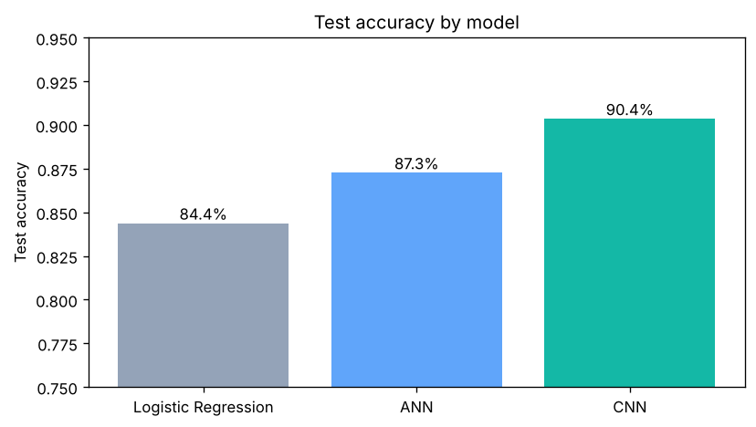
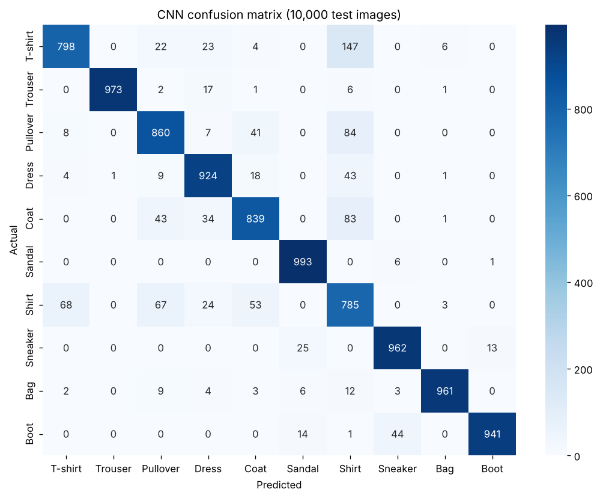
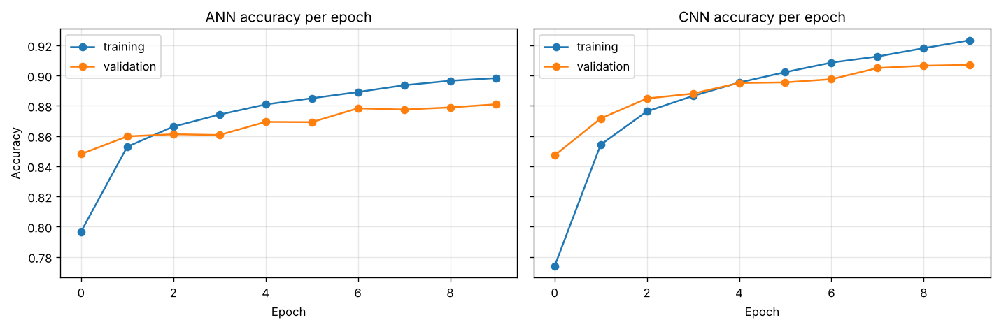
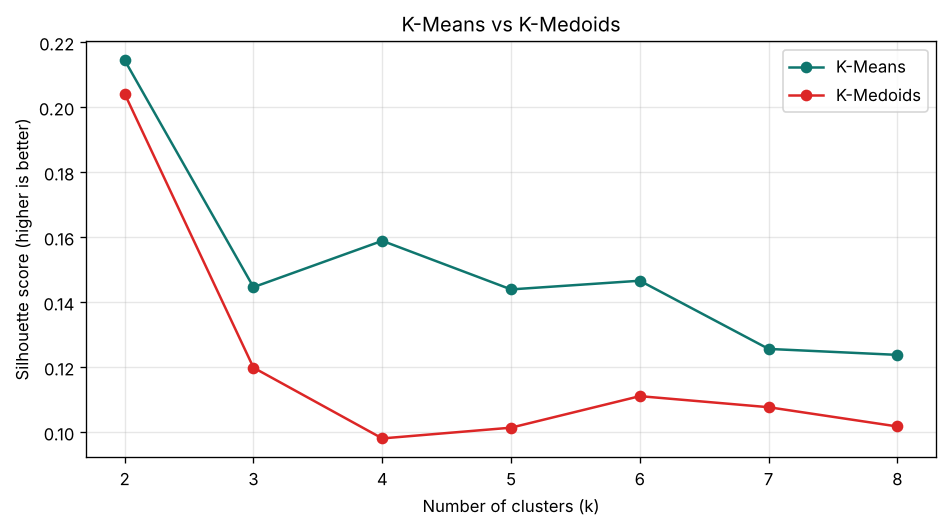
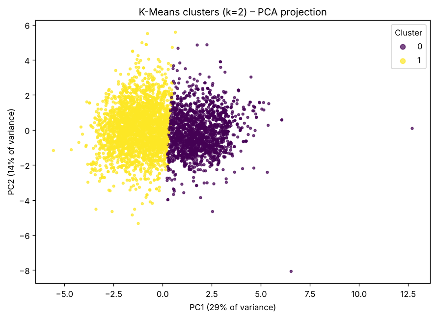
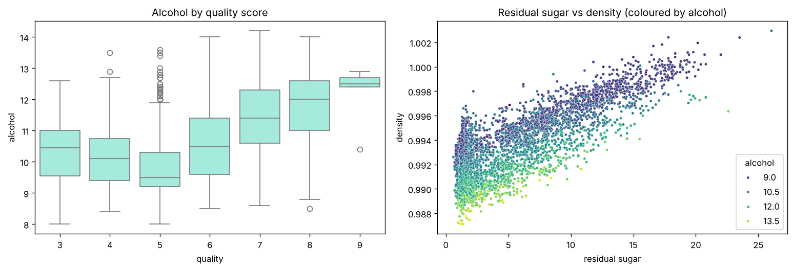

# Image Classification & Clustering with Machine Learning

  

Two machine-learning studies on real, public datasets:

1. **Supervised learning:** classifying clothing images from **Fashion-MNIST** with Logistic Regression, a neural network (ANN) and a convolutional neural network (CNN).
2. **Unsupervised learning:** finding natural groups of **white wines** from their chemistry with K-Means and K-Medoids.

| Notebook | Open and run it |
|---|---|
| [01 – Fashion-MNIST classification](notebooks/01_fashion_mnist_classification.ipynb) | [](https://colab.research.google.com/github/AlexRajdhami/ml-classification-clustering/blob/main/notebooks/01_fashion_mnist_classification.ipynb) |
| [02 – Wine quality clustering](notebooks/02_wine_quality_clustering.ipynb) | [](https://colab.research.google.com/github/AlexRajdhami/ml-classification-clustering/blob/main/notebooks/02_wine_quality_clustering.ipynb) |

## Results at a glance

### Part 1 – Fashion-MNIST (10,000 test images)

| Model | Test accuracy |
|---|---|
| Logistic Regression | 84.4% |
| Artificial Neural Network | 87.3% |
| **Convolutional Neural Network** | **90.4%** |



- The **CNN wins** because its convolution layers learn local shapes (edges, collars, soles) and keep the image's 2-D layout.
- Trousers, bags, sandals, sneakers and boots are recognised almost perfectly. **Shirts** are the hardest class: they are often confused with T-shirts, pullovers and coats.
- Training and validation accuracy stay close, so the models are not badly overfitting (dropout helps).

| CNN confusion matrix | Training curves |
|---|---|
|  |  |

### Part 2 – Wine Quality clustering (4,898 white wines, 11 features)

| Algorithm | Best silhouette score |
|---|---|
| **K-Means** | **0.214** (k = 2) |
| K-Medoids | 0.204 (k = 2) |



- **K-Means scores higher than K-Medoids for every k from 2 to 8.**
- A silhouette score of about 0.21 is modest. The wines form two broad, overlapping groups rather than sharply separated clusters, which is normal for continuous chemical data.
- The two groups make sense: **sweeter, denser, lower-alcohol wines** (average quality 5.6) and **drier, higher-alcohol wines** (average quality 6.1).

| PCA view of the clusters | Exploratory analysis |
|---|---|
|  |  |

## What's inside

```
notebooks/
  01_fashion_mnist_classification.ipynb   data prep, 3 models, reports, confusion matrix
  02_wine_quality_clustering.ipynb        EDA, scaling, K-Means, K-Medoids, PCA, cluster profiles
figures/                                  every chart, saved by the notebooks
requirements.txt
```

## Run it

**Easiest:** click an *Open in Colab* button above, then **Runtime → Run all**. Nothing to install.

**Locally (Python 3.10–3.12):**

```bash
python -m venv .venv
source .venv/bin/activate        # Windows: .venv\Scripts\activate
pip install -r requirements.txt
jupyter notebook notebooks/
```

Both datasets download automatically the first time. Part 1 takes a few minutes on a CPU, mostly training the CNN. Results can differ by a fraction of a percent between machines.

## Tech

Python · TensorFlow / Keras · scikit-learn · pandas · NumPy · Matplotlib · seaborn · pyclustering · Google Colab

## About this project

This started as group coursework (a team of five) for the Artificial Intelligence module of my BSc (Hons) Computer Science at the University of East London. I wrote the code and ran the experiments. For this repository I split the code into documented steps, made the runs repeatable with a fixed random seed, and added the training curves, labelled confusion matrix and cluster profiles.

**Datasets:** [Fashion-MNIST](https://github.com/zalandoresearch/fashion-mnist) by Zalando Research (MIT licence) and [Wine Quality](https://archive.ics.uci.edu/dataset/186/wine+quality) by Cortez et al., UCI Machine Learning Repository (CC BY 4.0).

**Author:** Alex Rajdhami · [LinkedIn](https://linkedin.com/in/alexrajdhami) · [GitHub](https://github.com/AlexRajdhami)
